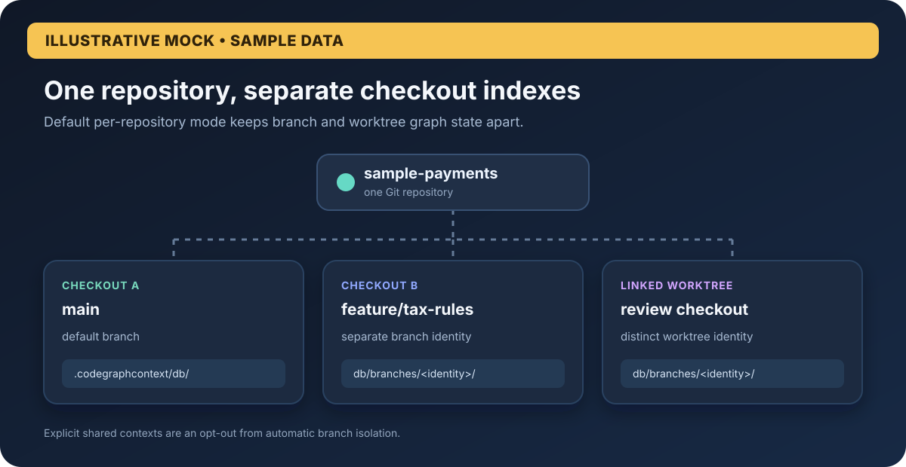
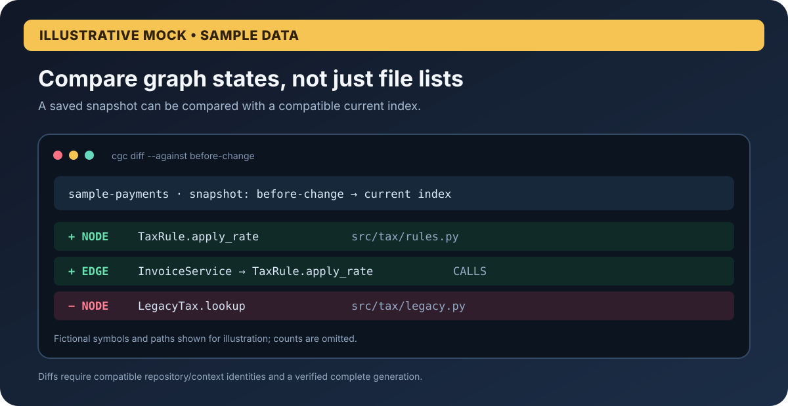
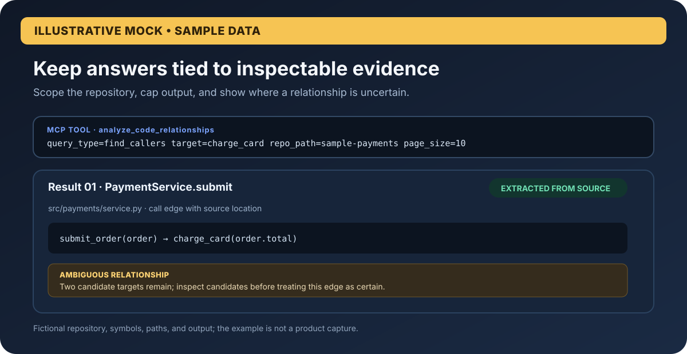
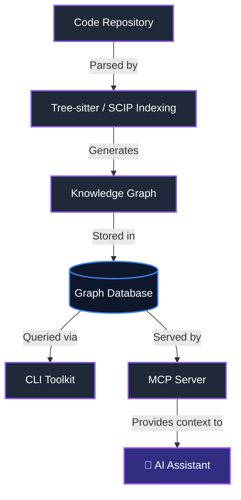

# 🏗️ CodeGraphContext (CGC)

**Turn code repositories into a queryable graph for AI agents.**

🌐 **Languages:**
- 🇬🇧 [English](README.md)
- 🇨🇳 [中文](docs/translations/README.zh-CN.md)
- 🇰🇷 [한국어](docs/translations/README.kor.md)
- 🇺🇦 [Українська](docs/translations/README.uk.md)
- 🇷🇺 [Русский](docs/translations/README.ru-RU.md)
- 🇯🇵 [日本語](docs/translations/README.ja.md)
- 🇮🇳 [தமிழ்](docs/translations/README.ta.md)
- 🇪🇸 Español (Soon)

<p align="center">
  <br>
  <b>Bridge the gap between deep code graphs and AI context.</b>
  <br><br>
  <a href="https://pypi.org/project/codegraphcontext-fork/">
    
  </a>
  <a href="https://pypi.org/project/codegraphcontext-fork/">
    
  </a>
  <a href="LICENSE">
    
  </a>
  
  <br><br>
  <a href="https://github.com/JohnXu22786/CodeGraphContext/stargazers">
    
  </a>
  <a href="https://github.com/JohnXu22786/CodeGraphContext/pulls">
    
  </a>
  <a href="https://github.com/JohnXu22786/CodeGraphContext/graphs/contributors">
    
  </a>
<br><br>
  <a href="https://github.com/JohnXu22786/CodeGraphContext/actions/workflows/test.yml">
    
  </a>
  <a href="https://github.com/JohnXu22786/CodeGraphContext/actions/workflows/e2e-tests.yml">
    
  </a>
</p>


CodeGraphContext indexes local repositories into a graph you can explore from the CLI or expose to an MCP client. This independently maintained project focuses on branch-aware local indexes, reviewable graph snapshots, and query results with inspectable evidence. [Read the source lineage and retained notices](UPSTREAM.md).

---

## 📍 Quick Navigation
* [🚀 Quick Start](#-installation--quick-start) 
* [📋 Prerequisites](#-prerequisites)
* [🏃 How to Run the Project Locally](#-how-to-run-the-project-locally)
* [🌐 Supported Programming Languages](#supported-programming-languages) 
* [🛠️ CLI Toolkit](#for-cli-toolkit-mode) 
* [🤖 MCP Server](#-for-mcp-server-mode) 
* [🗄️ Database Options](#database-options)
* [🔬 SCIP indexing (optional)](#scip-indexing-optional)

---

## CodeGraphContext: a local code graph for people and agents

CodeGraphContext (CGC) indexes a repository into a graph of symbols and relationships, then makes that graph available through the CLI and MCP. This repository is independently maintained, with a focus on safe local indexing, inspectable graph changes, and evidence-aware results. It builds on the existing CodeGraphContext project and retains its MIT license and author attribution.

CGC is operated through the CLI and MCP, with an optional graph visualization command; it is not a shipped desktop application. The visuals below are conceptual examples of the information its commands and tools can return, not product screenshots.

### What this project focuses on

- **Keep checkouts distinct.** In default per-repository mode, Git branches, detached checkouts, and linked worktrees receive separate local indexes. Explicit shared contexts remain available when desired.
- **Review graph changes.** Save a graph snapshot and compare it with a later index using `cgc snapshot` and `cgc diff`. Comparisons reject stale or incomplete generations and mismatched repositories or contexts.
- **See how findings were derived.** Relationship and analysis results can include confidence labels, provenance, reasons, and bounded source evidence; ambiguous resolutions remain visible as ambiguous.
- **Keep queries scoped and manageable.** Repository filters and result limits help keep graph queries focused. Use the local CLI directly or connect an MCP client to the server.

### Illustrative feature views

These are **illustrative mocks with sample data**, not screenshots of a shipped graphical interface.

<p align="center">
  
</p>
<p align="center"><em>Illustrative mock — sample repository and branch names. Default per-repository indexing isolates branch and worktree state.</em></p>

<p align="center">
  
</p>
<p align="center"><em>Illustrative mock — sample graph changes. Use <code>cgc snapshot save</code> and <code>cgc diff --against</code> to compare compatible saved and current indexes.</em></p>

<p align="center">
  
</p>
<p align="center"><em>Illustrative mock — sample query output. Results can carry source evidence and confidence metadata; the example values are fictional.</em></p>

### A short local workflow

```bash
# Install the current package and index a repository
python -m pip install codegraphcontext-fork
cgc index /path/to/your/repository

# Save a point-in-time graph and compare it later
cgc snapshot save --name before-change
cgc diff --against before-change

# Configure an MCP client, or use the graph tools directly from the CLI
cgc mcp setup
```

Snapshots are most useful with supported embedded backends that can report a verified completed generation. Shared or remote backends without a durable completion marker are treated as incomplete for diffing. CGC does not migrate an explicitly selected shared database into branch-isolated storage. See the [indexing guide](docs/docs/guides/indexing.md) and [MCP tool reference](docs/MCP_TOOLS.md) for details.

### Common use cases

- Trace callers, callees, and call chains across files.
- Explore imports, inheritance, module boundaries, and dependencies.
- Review graph changes between saved index states.
- Give an MCP-connected assistant repository structure alongside bounded source evidence.

### FAQ

- **Does CGC require a hosted service?** No. It can use a local embedded graph database; remote backends are optional.
- **Does it include a desktop application?** No. The supported workflows are the CLI and MCP server; `cgc visualize` can open an optional graph view. The feature visuals here are conceptual mocks.
- **Can it be used by an AI assistant?** Yes. Configure an MCP client with `cgc mcp setup`, or use the CLI without an assistant.

---

## Project Details
- **Version:** 0.7.0
- **Authors:** Shashank Shekhar Singh <shashankshekharsingh1205@gmail.com>
- **License:** MIT License (See [LICENSE](LICENSE) for details)

---

## 👨‍💻 Original project author
The existing CodeGraphContext project was created by:

**Shashank Shekhar Singh**  
- 📧 Email: [shashankshekharsingh1205@gmail.com](mailto:shashankshekharsingh1205@gmail.com)
- 🐙 GitHub: [@Shashankss1205](https://github.com/Shashankss1205)
- 🔗 LinkedIn: [Shashank Shekhar Singh](https://www.linkedin.com/in/shashank-shekhar-singh-a67282228/)
- 🌐 Website: [codegraphcontext.vercel.app](https://codegraphcontext.vercel.app/)

Source lineage and retained notices are documented in [UPSTREAM.md](UPSTREAM.md).

---

## Star History
[Star History Chart ↗](https://www.star-history.com/#JohnXu22786/CodeGraphContext&Date)
<!-- The inline chart image is temporarily removed: api.star-history.com currently
     renders "GitHub restricted access to star data" instead of the chart
     (GitHub-side restriction, see PR #1642). Restore the image once the
     official service recovers:
     [](https://www.star-history.com/#JohnXu22786/CodeGraphContext&Date) -->

---

## Features
-   **Code Indexing:** Analyzes code and builds a knowledge graph of its components.
-   **Relationship Analysis:** Query for callers, callees, class hierarchies, call chains and more.
-   **Pre-indexed Bundles:** Load famous repositories instantly with `.cgc` bundles - no indexing required! ([Learn more](docs/docs/guides/bundles.md))
-   **Live File Watching:** Watch directories for changes and automatically update the graph in real-time (`cgc watch`).
-   **Interactive Setup:** A user-friendly command-line wizard for easy setup.
-   **Dual Mode:** Works as a standalone **CLI toolkit** for developers and as an **MCP server** for AI agents.
-   **Multi-Language Support:** Full support for 23 programming languages.
-   **Flexible Database Backend:** LadybugDB (default embedded backend), optional FalkorDB Lite, KuzuDB, FalkorDB Remote, Nornic DB, or Neo4j.


---

## 🏗️ Architecture & Workflow

CodeGraphContext parses your source code and builds a comprehensive knowledge graph. This graph can be queried directly via the CLI toolkit or exposed to AI assistants through the MCP server.



---

## Supported Programming Languages

CodeGraphContext provides comprehensive parsing and analysis for the following languages:

| | Language | | Language | | Language |
| :--- | :--- | :--- | :--- | :--- | :--- |
| 🐍 | **Python** | 📜 | **JavaScript** | 🔷 | **TypeScript** |
| ☕ | **Java** | 🔵 | **C** | ➕ | **C++** |
| #️⃣ | **C#** | 🐹 | **Go** | 🦀 | **Rust** |
| 💎 | **Ruby** | 🐘 | **PHP** | 🍎 | **Swift** |
| 🎨 | **Kotlin** | 🎯 | **Dart** | 🐪 | **Perl** |
| 🌙 | **Lua** | 🚀 | **Scala** | λ | **Haskell** |
| 💧 | **Elixir** | 📜 | **Emacs Lisp (elisp)** | 🌐 | **HTML** |
| 🎨 | **CSS** | ⚛️ | **TSX** | ⛓️ | **Solidity** |
| 🏗️ | **HCL (Terraform/Terragrunt)** | | | | |

Each language parser extracts functions, classes, methods, parameters, inheritance relationships, function calls, and imports to build a comprehensive code graph.

**HCL notes:** `.tf`, `.tfvars` and `.hcl` cover Terraform, OpenTofu and Terragrunt. HCL declares
rather than calls, so it contributes blocks, variables and cross-configuration imports but no
function calls. See `docs/docs/contributing_languages.md` § HCL.

**Solidity notes:** `.sol` uses Tree-sitter via `tree-sitter-language-pack` (no SCIP). Supports Foundry remappings, modifier invocations, `using Lib for T`, and `emit` / custom-error `revert` as CALLS. See `docs/docs/contributing_languages.md` § Solidity.

**Kotlin notes:** Annotations are recorded on functions and classes as `decorators`, retaining
their arguments (`@Preview(showBackground = true)`). This makes `find_dead_code`'s
`exclude_decorated_with` usable on Kotlin and Android codebases — for example excluding
`Composable`, `Preview`, `Test` and `Provides`. That filter matches on functions, so class-level
annotations do not affect it. Annotations on interfaces, objects, constructors, parameters and
properties are not yet recorded.

---

## Database Options

CodeGraphContext supports multiple graph database backends to suit your environment:

| Feature | KuzuDB | LadybugDB | FalkorDB Lite | Neo4j / Nornic DB |
| :--- | :--- | :--- | :--- | :--- |
| **Typical default** | Optional embedded backend | **Default embedded backend** | Optional on Unix (Python 3.12+, when its extra is installed) | When explicitly configured via `cgc config db` |
| **Setup** | Zero-config / Embedded | Zero-config / Embedded | Zero-config / In-process | Docker / External |
| **Platform** | Linux/macOS/Windows (no macOS/Windows Python 3.14 wheel) | **All (Windows Native, macOS, Linux)** | Unix-only (Linux/macOS/WSL) | All Platforms |
| **Use Case** | Desktop, IDE, Local development | Custom research projects | Specialized Unix development | Enterprise, Massive graphs |
| **Requirement**| `python -m pip install 'codegraphcontext-fork[kuzu]'` | Included in the default install | `python -m pip install 'codegraphcontext-fork[falkordb-embedded]'` | Neo4j Server / Docker / Nornic Cloud plus `python -m pip install 'codegraphcontext-fork[neo4j]'` |
| **Speed** | ⚡ Extremely Fast | ⚡ Fast | 🚀 Scalable | 🌐 Network-dependent |
| **Persistence**| Yes (to disk) | Yes (to disk) | Yes (to disk) | Yes (server-side) |

Embedded KuzuDB/LadybugDB default to a **4 GiB** buffer pool (`CGC_EMBEDDED_BUFFER_POOL_MB`). Set that env var to another MiB value, or `0` for the library default (~80% of system RAM).

---

## SCIP indexing (optional)

When `SCIP_INDEXER=true` in your CGC config (`~/.codegraphcontext/.env`), some languages use external **SCIP** indexers for more accurate calls and inheritance than Tree-sitter heuristics alone.

**C and C++** use **scip-clang**, which requires a **`compile_commands.json`** file (a [JSON compilation database](https://clang.llvm.org/docs/JSONCompilationDatabase.html)): one entry per translation unit with the real compiler command (include paths, `-D` defines, `-std`, etc.). Without it, scip-clang cannot run; CGC logs a warning and **falls back to Tree-sitter** for that repo. Typical ways to produce the file: **CMake** with `-DCMAKE_EXPORT_COMPILE_COMMANDS=ON`, or wrap your real build with **[Bear](https://github.com/rizsotto/Bear)** (e.g. `bear -- make`). CGC also looks under `build/` and `cmake-build-*/` for that filename.

**C#** uses **scip-dotnet** (Roslyn); you need a normal **`.csproj` / `.sln`** and a successful restore—no `compile_commands.json`.

SCIP is **independent of which graph database** you use (Kuzu, Neo4j, etc.); the same flag applies to all backends.

---

## Used By

CodeGraphContext is already being explored by developers and projects for:

- **Static code analysis in AI assistants**
- **Graph-based visualization of projects**
- **Dead code and complexity detection**

_If you’re using CodeGraphContext in your project, feel free to open a PR and add it here! 🚀_

---

## Dependencies

- `watchdog>=3.0.0`
- `stdlibs>=2023.11.18`
- `typer>=0.9.0`
- `rich>=13.7.0`
- `inquirerpy>=0.3.4`
- `python-dotenv>=1.0.0`
- `tree-sitter>=0.24.0,<0.26.0`
- `tree-sitter-language-pack>=1.6,<1.21.0`
- `pyyaml`
- `pathspec>=0.12.1`
- `ladybug>=0.19,<0.20` (default embedded database)
- `fastapi>=0.100.0`
- `uvicorn>=0.22.0`
- `requests>=2.28.0`
- `protobuf>=3.20,<3.21`

**Note:** Python 3.10-3.14 is supported.

Optional database backends can be installed separately with `codegraphcontext-fork[falkordb-embedded]`, `codegraphcontext-fork[falkordb-remote]`, `codegraphcontext-fork[kuzu]`, or `codegraphcontext-fork[neo4j]` (Neo4j and Nornic).

---

### 🚀 Installation & Quick Start

> Install this distribution in a dedicated Python virtual environment. The upstream `codegraphcontext` distribution and the `codegraphcontext-fork` distribution both install the `codegraphcontext` import package, so do not install them into the same environment. The CLI commands remain `cgc` and `codegraphcontext`.

Version 0.7.0 is published on PyPI. Use the isolated environment below to avoid conflicts with another distribution that installs the same import package.

The commands below use Bash on macOS/Linux. In PowerShell, activate the environment with `.\.venv\Scripts\Activate.ps1`; in Command Prompt, use `.venv\Scripts\activate.bat`.

1.  **Install the toolkit:**
    ```bash
    python -m venv .venv
    source .venv/bin/activate
    python -m pip install codegraphcontext-fork
    ```

2.  **Troubleshooting (Command not found):**
    If the `codegraphcontext` command is not found, reactivate `.venv` in this shell using the activation command above. On Windows, use the PowerShell or Command Prompt activation command shown above.

3.  **Database Setup (Automatic):**
    CodeGraphContext uses the included LadybugDB embedded backend by default.
    - **FalkorDB Lite:** Optional on Unix with Python 3.12+; install `codegraphcontext-fork[falkordb-embedded]` and select it with `cgc config db falkordb`.
    - **KuzuDB:** Optional embedded backend; Python 3.14 support is Linux-only because macOS and Windows wheels are unavailable. Install `codegraphcontext-fork[kuzu]`.
    - **Neo4j or Nornic:** Install `codegraphcontext-fork[neo4j]`; run `codegraphcontext neo4j setup` for Neo4j.
    - **Data-source ingestion:** Install `codegraphcontext-fork[datasources]` to use the MySQL, Cassandra, or Redis ingestion commands.

### 🧪 Local Development Setup

If you want to run CodeGraphContext from a local clone and contribute changes, use an editable install:

```bash
git clone https://github.com/JohnXu22786/CodeGraphContext.git
cd CodeGraphContext
python -m venv .venv
source .venv/bin/activate
pip install -e ".[dev]"
```

Then verify the install and try the local commands:

```bash
cgc --help
cgc doctor
cgc index .
cgc analyze callers main
```

For MCP server work, finish the setup with:

```bash
cgc mcp setup
cgc mcp start
```

For parser-heavy development, install the optional parsing extras with `pip install -e ".[dev,parsing]"`.

---

## 🐳 Docker (No Python Required)

Run CodeGraphContext without installing Python — pull the image and start indexing:

The public container image is available from GitHub Container Registry; anonymous pulls are supported.

### Quick Start
```bash
# Pull the latest image
docker pull ghcr.io/johnxu22786/codegraphcontext:latest

# Index your current directory
docker run --rm -v "$(pwd):/workspace" ghcr.io/johnxu22786/codegraphcontext cgc index .

# List indexed repos
docker run --rm -v cgc-data:/home/cgc/.codegraphcontext \
    ghcr.io/johnxu22786/codegraphcontext cgc list

# Interactive shell
docker run -it --rm -v "$(pwd):/workspace" \
    -v cgc-data:/home/cgc/.codegraphcontext \
    ghcr.io/johnxu22786/codegraphcontext bash
```

### Docker Compose
```bash
# Clone the repo and start with Docker Compose
git clone https://github.com/JohnXu22786/CodeGraphContext.git
cd CodeGraphContext

# Start with embedded DB
docker compose run --rm cgc index .

# Start with external FalkorDB
docker compose --profile falkordb up -d

# Start with visualization server
docker compose --profile viz up -d
# Open http://localhost:8080
```

### Available Docker Tags
| Tag | Description |
|---|---|
| `latest` | Latest stable release |
| `edge` | Latest from `main` branch (may be unstable) |
| `0.7.0` | Fork release tag (available after publication) |

For more advanced Docker usage, including running the MCP Server or connecting external databases, see our [Comprehensive Docker Guide](docs/DOCKER.md).

---

## 📋 Prerequisites

Before installing CodeGraphContext, ensure you have:

* Python 3.10 or later
* pip package manager
* Git (optional, for cloning repositories)

Verify your Python installation:

```bash
python --version
```

---

## 🚀 Step-by-Step Setup Guide

### Step 1: Install CodeGraphContext

Version 0.7.0 is published on PyPI. The commands below install it into an isolated environment.

```bash
python -m venv .venv
source .venv/bin/activate
python -m pip install codegraphcontext-fork  # Installs CodeGraphContext and required dependencies
```

This command installs CodeGraphContext and all required dependencies.

### Step 2: Verify Installation

```bash
codegraphcontext --help
```

If the command displays the available CLI commands, the installation was successful.

### Step 3: Database Setup

CodeGraphContext automatically uses an embedded database by default, so no additional configuration is required for most users.

---

## 🏃 How to Run the Project Locally

### Index a Repository

```bash
codegraphcontext index .  # Scans current directory and builds code graph
```

This scans the current project and creates a searchable code graph.

### View Indexed Repositories

```bash
codegraphcontext list
```

Displays all repositories currently indexed by CodeGraphContext.

### Analyze Code

```bash
codegraphcontext analyze dead-code
```

Finds potentially unused code in the indexed repository.

---

## ✅ Verify Everything Works

After indexing a repository, run:

```bash
codegraphcontext list  # Shows all indexed repositories in the system
```

If the command executes successfully and displays indexed repositories, your setup is complete and CodeGraphContext is ready to use.

### For CLI Toolkit Mode

**Start using immediately with CLI commands:**
```bash
# Index your current directory
codegraphcontext index .

# List all indexed repositories
codegraphcontext list

# Analyze who calls a function
codegraphcontext analyze callers my_function

# Find complex code
codegraphcontext analyze complexity --threshold 10

# Find dead code
codegraphcontext analyze dead-code

# Watch for live changes (optional)
codegraphcontext watch .

# See all commands
codegraphcontext help
```

  **See the full [CLI Commands Guide](docs/CLI_COMPLETE_REFERENCE.md) for all available commands and usage scenarios.**

### 🎨 Premium Interactive Visualization
CodeGraphContext can generate stunning, interactive knowledge graphs of your code. Unlike static diagrams, these are premium web-based explorers:

- **Premium Aesthetics**: Dark mode, glassmorphism, and modern typography (Outfit/JetBrains Mono).
- **Interactive Inspection**: Click any node to open a detailed side panel with symbol information, file paths, and context.
- **Quick Search**: Live-search through the graph to find specific symbols instantly.
- **Intelligent Layouts**: Force-directed and hierarchical layouts that make complex relationships readable.
- **Zero-Dependency Viewing**: Standalone HTML files that work in any modern browser.

```bash
# Visualize function calls
codegraphcontext analyze calls my_function --viz

# Explore class hierarchies
codegraphcontext analyze tree MyClass --viz

# Visualize search results
codegraphcontext find pattern "Auth" --viz
```


---

### 🤖 For MCP Server Mode

**Configure your AI assistant to use CodeGraphContext:**
1.  **Setup:** Run the MCP setup wizard to configure your IDE/AI assistant:
    
    ```bash
    codegraphcontext mcp setup
    ```
    
    The wizard can automatically detect and configure:
    *   VS Code
    *   Cursor
    *   Windsurf
    *   Zed
    *   Claude
    *   Gemini CLI
    *   ChatGPT Codex
    *   Cline
    *   RooCode
    *   Amazon Q Developer
    *   Kiro
    *   Goose
    *   OpenCode

    Upon successful configuration, `codegraphcontext mcp setup` will generate and place the necessary configuration files:
    *   It creates an `mcp.json` file in your current directory for reference.
    *   It stores your database credentials securely in `~/.codegraphcontext/.env`.
    *   It updates the settings file of your chosen IDE/CLI (e.g., `.claude.json` or VS Code's `settings.json`).

2.  **Start:** Launch the MCP server:    
    ```bash
    codegraphcontext mcp start
    ```

3.  **Use:** Now interact with your codebase through your AI assistant using natural language! See examples below.

---

## Ignoring Files (`.cgcignore`)

You can tell CodeGraphContext to ignore specific files and directories by creating a `.cgcignore` file in the root of your project. This file uses the same syntax as `.gitignore`.

**Example `.cgcignore` file:**
```
# Ignore build artifacts
/build/
/dist/

# Ignore dependencies
/node_modules/
/vendor/

# Ignore logs
*.log
```

---

## MCP Client Configuration

The `codegraphcontext mcp setup` command attempts to automatically configure your IDE/CLI. If you choose not to use the automatic setup, or if your tool is not supported, you can configure it manually. Desktop clients do not inherit the active virtual environment from your terminal. Before publication, use the absolute path to `cgc` in your dedicated virtual environment. The `pipx` example below works after the 0.7.0 PyPI publication and requires `pipx` on the client's own `PATH`.

Add the following server configuration to your client's settings file (e.g., VS Code's `settings.json` or `.claude.json`):

```json
{
  "mcpServers": {
    "CodeGraphContext": {
      "command": "pipx",
      "args": [
        "run",
        "--spec",
        "codegraphcontext-fork",
        "codegraphcontext",
        "mcp",
        "start"
      ],
      "env": {
        "NEO4J_URI": "YOUR_NEO4J_URI",
        "NEO4J_USERNAME": "YOUR_NEO4J_USERNAME",
        "NEO4J_PASSWORD": "YOUR_NEO4J_PASSWORD"
      },
      "disabled": false,
      "alwaysAllow": []
    }
  }
}
```

#### OpenCode Configuration

For instructions on installing and configuring MCP servers with OpenCode, see the [OpenCode MCP Guide](https://opencode.ai/docs/ko/mcp-servers/#_top).

---

## Token-Optimized Output (GCF)

Reduce tool response tokens by ~62% with the opt-in [GCF](https://gcformat.com) output format:

```bash
pip install gcf-python
CGC_OUTPUT_FORMAT=gcf codegraphcontext mcp start
```

Or add it to your MCP client config:

The `pipx` example below works after the 0.7.0 PyPI publication.

```json
{
  "mcpServers": {
    "CodeGraphContext": {
      "command": "pipx",
      "args": [
        "run",
        "--spec",
        "codegraphcontext-fork",
        "codegraphcontext",
        "mcp",
        "start"
      ],
      "env": {
        "CGC_OUTPUT_FORMAT": "gcf"
      }
    }
  }
}
```

GCF encodes structured data with positional fields (keys declared once, values pipe-delimited). Code graph query results (symbols, relationships, callers, complexity) are exactly the data shape where GCF saves the most. 100% LLM comprehension on all frontier models. Falls back to JSON if `gcf-python` is not installed.

---

## Natural Language Interaction Examples

Once the server is running, you can interact with it through your AI assistant using plain English. Here are some examples of what you can say:

### Indexing and Watching Files

-   **To index a new project:**
    -   "Please index the code in the `/path/to/my-project` directory."
    OR
    -   "Add the project at `~/dev/my-other-project` to the code graph."


-   **To start watching a directory for live changes:**
    -   "Watch the `/path/to/my-active-project` directory for changes."
    OR
    -   "Keep the code graph updated for the project I'm working on at `~/dev/main-app`."

    When you ask to watch a directory, the system performs two actions at once:
    1.  It kicks off a full scan to index all the code in that directory. This process runs in the background, and you'll receive a `job_id` to track its progress.
    2.  It begins watching the directory for any file changes to keep the graph updated in real-time.

    This means you can start by simply telling the system to watch a directory, and it will handle both the initial indexing and the continuous updates automatically.

### Querying and Understanding Code

-   **Finding where code is defined:**
    -   "Where is the `process_payment` function?"
    -   "Find the `User` class for me."
    -   "Show me any code related to 'database connection'."

-   **Analyzing relationships and impact:**
    -   "What other functions call the `get_user_by_id` function?"
    -   "If I change the `calculate_tax` function, what other parts of the code will be affected?"
    -   "Show me the inheritance hierarchy for the `BaseController` class."
    -   "What methods does the `Order` class have?"

-   **Exploring dependencies:**
    -   "Which files import the `requests` library?"
    -   "Find all implementations of the `render` method."

-   **Advanced Call Chain and Dependency Tracking (Spanning Hundreds of Files):**
    The CodeGraphContext excels at tracing complex execution flows and dependencies across vast codebases. Leveraging the power of graph databases, it can identify direct and indirect callers and callees, even when a function is called through multiple layers of abstraction or across numerous files. This is invaluable for:
    -   **Impact Analysis:** Understand the full ripple effect of a change to a core function.
    -   **Debugging:** Trace the path of execution from an entry point to a specific bug.
    -   **Code Comprehension:** Grasp how different parts of a large system interact.

    -   "Show me the full call chain from the `main` function to `process_data`."
    -   "Find all functions that directly or indirectly call `validate_input`."
    -   "What are all the functions that `initialize_system` eventually calls?"
    -   "Trace the dependencies of the `DatabaseManager` module."

-   **Code Quality and Maintenance:**
    -   "Is there any dead or unused code in this project?"
    -   "Calculate the cyclomatic complexity of the `process_data` function in `src/utils.py`."
    -   "Find the 5 most complex functions in the codebase."

-   **Repository Management:**
    -   "List all currently indexed repositories."
    -   "Delete the indexed repository at `/path/to/old-project`."

---

## Troubleshooting

Hitting a lock error, a "never finishes indexing" loop, or a silent feature?
See [docs/TROUBLESHOOTING.md](docs/TROUBLESHOOTING.md) — every entry maps a
real reported issue to its fix or workaround.

---

## Contributing

Contributions are welcome! 🎉  
Please see our [CONTRIBUTING.md](.github/CONTRIBUTING.md) for detailed guidelines.
If you have ideas for new features, integrations, or improvements, open an [issue](https://github.com/JohnXu22786/CodeGraphContext/issues) or submit a Pull Request.

Join discussions and help shape the future of CodeGraphContext.
