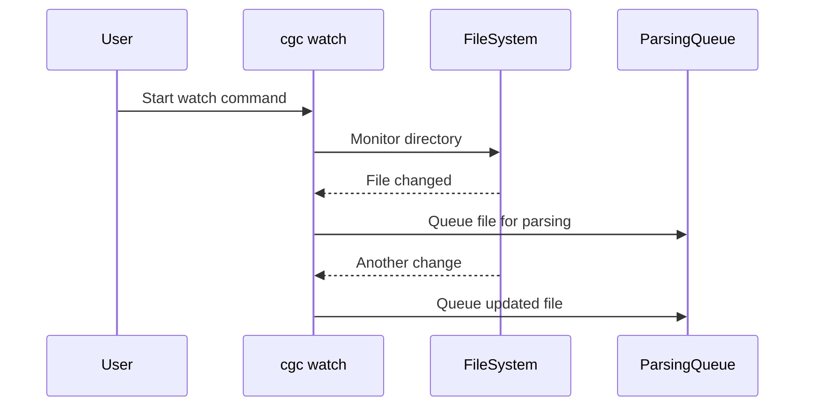

# Indexing Source Code

Indexing extracts syntactic structures and links semantic relationships within a codebase to populate the graph database. CodeGraphContext (CGC) supports multiple scan strategies.

---

## 1. Local Workspace Indexing

To index the repository directory you are currently working in, navigate to the folder and run:

```bash
cd /path/to/project
cgc index
```

### Ingestion Scopes
By default, the `index` command scans all supported source files in the current working directory. You can narrow the scope by specifying a target subdirectory or file:

```bash
# Index only the core module folder
cgc index ./src/core

# Index a single file
cgc index ./src/main.py
```

### Refreshing an Existing Index
`cgc index` skips a repository that is already fully indexed; it does not compare existing files by timestamp or content hash. Use `cgc update` or `cgc index --force` to refresh a repository after external file or configuration changes. A parser or grammar package upgrade requires restarting any long-running CGC process first, so it loads the new parser and grammar objects before rebuilding. These refresh commands remove the old repository graph and rebuild it:

```bash
cgc update
# equivalent full rebuild:
cgc index --force
```

---

## 2. Ingesting Third-Party Packages

To trace references to external dependencies (e.g., standard library classes or package functions), you can manually add installed Python libraries to your active code graph.

Use the `add-package` command:

```bash
# Ingest requests library
cgc add-package requests python
```

The command resolves the package's installation path on your system, parses its definitions, and appends the nodes to your active context.

---

## 3. SCIP and `.cgcignore`

When `SCIP_INDEXER=true`, external SCIP tools run on eligible source files. SCIP ingestion **respects `.cgcignore`** the same way Tree-sitter indexing does—ignored paths are not passed to SCIP indexers.

C and C++ SCIP requires a `compile_commands.json` in the project (or under `build/` / `cmake-build-*/`). Without it, CGC logs a warning and falls back to Tree-sitter for those files.

---

## 4. Real-Time Directory Watchers

For active development, run a filesystem watcher in the background to capture file writes and incrementally sync the graph.

```bash
# Start watching the active workspace
cgc watch
```



- **Listing Watchers**: View active file monitors with:
  ```bash
  cgc watching
  ```
- **Stopping Watchers**: Terminate directory monitoring using:
  ```bash
  cgc unwatch /path/to/project
  ```

On startup, each watcher can **reconcile** the graph with disk: files present on disk but missing from the graph are indexed, and graph entries for deleted files are removed before live monitoring begins.

This is **off by default** — pass `--sync-on-start` to enable it. Without it, changes made while the watcher was not running are not picked up for an already-indexed repository.

---

## 5. Ingest Filters (`.cgcignore`)

To prevent compiling bloated indices or parsing build artifacts, define ignore rules in a `.cgcignore` file in the root of your repository or context directory.

### Glob Pattern Rules:
- Lines starting with `#` are treated as comments.
- Directories should terminate with a trailing slash `/`.
- Supports wildcards (`*`) and recursive matches (`**/`).

### Typical `.cgcignore` Configuration:
```text
# Exclude build and compiled outputs
build/
dist/
*.egg-info/
__pycache__/
*.pyc

# Exclude dependency libraries
node_modules/
.venv/
venv/
env/

# Exclude IDE configurations
.git/
.vscode/
.idea/
.project
```

## 6. Branch and worktree indexes

In the default **per-repository** mode, CGC keeps the root checkout's default
branch at the existing `.codegraphcontext/db/<backend>` location. Other
branches, detached checkouts, and linked worktrees use separate hashed
directories below `.codegraphcontext/db/branches/`. The hash includes the
repository, branch, and worktree identity; snapshot documents include the Git
commit, context, generation ID, and completion state without storing checkout
absolute paths.

Before CGC can certify an older local database as a complete generation, run
`cgc index` once on the full checkout root. Indexing a subdirectory or running
a partial operation such as package indexing, cleanup, or a watcher event
cannot certify a database that was previously unknown or incomplete. Databases
without a verified identity marker are reindexed instead of being assumed to
match the current branch or commit.

An explicit `--context`, named context, or `CGC_RUNTIME_DB_PATH` continues to
use the configured shared database. That is an intentional opt-out from
automatic branch isolation. CGC does not move or migrate those databases.
Non-Git directories continue to use their existing per-repository database
location. Detached HEADs are identified by commit SHA.

Completion markers are currently supported for embedded FalkorDB, Kùzu, and
LadybugDB stores. Neo4j and other remote/shared backends do not yet have a
durable CGC generation marker, so their snapshots remain marked incomplete and
`cgc diff` refuses to compare them until that backend can report a verified
completed generation.

Watchers are bound to the branch/worktree that selected their database. If the
checkout switches to a different branch or worktree while a watcher is running,
the watcher stops applying updates to that database; restart CGC to resolve the
new identity. Same-branch commits continue to use the same branch index.
Embedded-backend watcher updates temporarily mark the generation as building;
snapshot capture overlapping an update is rejected and can be retried after the
watcher finishes.

Save and compare graph snapshots with:

```bash
cgc snapshot save --name before-refactor
cgc snapshot list
cgc diff --against before-refactor
```

Snapshots are kept under the user's CGC configuration directory, grouped by a
safe repository hash, and are not pruned automatically. Diff output sorts graph
records deterministically. A symbol move is paired only when its structural
signature is unique on both sides; ambiguous duplicate names remain additions
and removals. Diffs reject incomplete/stale generations, different repositories,
and different contexts. The matching and ambiguity handling are adapted from
the MIT-licensed upstream draft PR [#1736](https://github.com/CodeGraphContext/CodeGraphContext/pull/1736)
by yashraj4; its branch-isolation and generation behavior were not included in
that draft.
